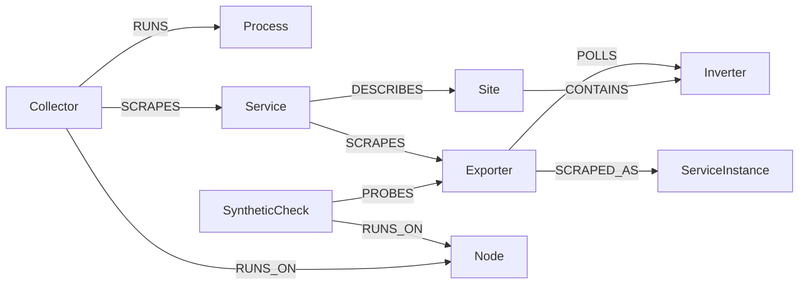

# Knowledge Graph

## The product

The [Knowledge Graph](https://grafana.com/docs/grafana-cloud/platform/knowledge-graph/get-started/) turns metrics into entities and edges, then colors an entity from alert rules that carry assertion labels. The RCA workbench, under Observability, is where you look at that color over time. Grafana discovers Node, Service, ServiceInstance, Process, and SyntheticCheck on its own. Custom types (a site, an inverter) come from model rules: a PromQL query, the label that names the entity, and the label that supplies the `env` scope.

A health rule colors the graph when it notifies the `grafana-insight-processor` contact point and its labels include `asserts_severity`, `asserts_alert_category`, and `asserts_entity_type`. The firing series has to carry `asserts_env` and `asserts_site`. That contact point is not a page. Paging stays on the notification policy.

The built-in Metrics tab on an entity reads Grafana's `asserts:*` recording rules (request rate, error ratio, latency). Those series do not exist for a custom type. The supported replacement is a dashboard linked by hand under **Observability > Configuration > KPI display options**. There is no API, Terraform resource, or gcx command for that link.

## This stack

The app is activated on the `lewism` stack. [knowledge-graph/model-rules.yaml](https://github.com/lewismc/solaredge-olly/blob/main/knowledge-graph/model-rules.yaml) is the ruleset `solaredge-home`, applied with `gcx kg model-rules upsert`. It adds Site, Inverter, Exporter, and Collector. Node, Service, ServiceInstance, Process, and SyntheticCheck stay the built-in ones. The ten relations put the home on one cluster.

The diagram is generated from [model-rules.yaml](https://github.com/lewismc/solaredge-olly/blob/main/knowledge-graph/model-rules.yaml) with `render_mermaid.py` from the entity-graph-wizard skill. Five built-in types appear as nodes so their edges have an endpoint.

Each join is one series that already carries both ends:

| Relation | Series | Why it joins |
| :--- | :--- | :--- |
| Site CONTAINS Inverter | `Inverter_Info` | A fixed `site` label is added. The Site is static, named `solaredge-site`, because geolocate publishes no site id. |
| Service DESCRIBES Site | `Site_Expected_AC_Power_W` | Same fixed `site` label. The Service name is the `job` label. |
| Exporter POLLS Inverter | `Modbus_Read_OK` | The exporter name is `label_replace` of `instance`. The inverter label is already on the series. |
| SyntheticCheck PROBES Exporter | `sm_check_info` | The check name is `job` and `instance` joined by `__`. The exporter name is the host and port in the URL. The check has no env scope, so it is matched by name only. |
| Collector RUNS Process | `alloy_build_info` | The process name is `job` and `instance` joined by `:`. |
| Collector RUNS_ON Node | `alloy_build_info` | `instance` is the node name. |
| SyntheticCheck RUNS_ON Node | `sm_check_info` | `probe` is the node name. |
| Exporter SCRAPED_AS ServiceInstance | `up` | The ServiceInstance name is `job` and `instance` joined by `:`. |
| Collector SCRAPES Service | `prometheus_target_scrape_pool_targets` | `collector_id` and `scrape_job` are on one series, for the three jobs `integrations/solaredge`, `integrations/solaredge-geolocate`, and `integrations/raspberrypi-node`. |
| Service SCRAPES Exporter | `up` | The Service name is `job`. The exporter name is `instance`. |

`asserts_env` has to be a label of that name or the API returns 422. Scrape jobs copy it from `deployment_environment`. Alloy's own series have no `deployment_environment`, so those rules set `asserts_env` to the fixed value `home`. `label_replace` on `Modbus_Read_OK` and `up` selects `asserts_env!=""` so it does not collide with a copy that already has the label. Each relation matcher repeats the one scope key. A new edge can take 2 to 30 minutes to show. `gcx kg graph query` needs a top-level `LIMIT` of 300 or less.

There are no calls/min recording rules. Grafana's `asserts:relation:calls` draws a Service-to-Service call edge, and nothing here counts requests except the synthetic check. A recording rule would draw that edge, which is a different fact from PROBES.

The stack dataset config has one filter group whose environment label is already `deployment_environment`. It was left unchanged. Editing it applies to the whole stack.

**Health rules.** Folder `knowledge-graph` (UID `alerting-tprwygwwerdz`), group `solaredge-home-health`, receiver `grafana-insight-processor`. The files are in [knowledge-graph/alertrules/](https://github.com/lewismc/solaredge-olly/tree/main/knowledge-graph/alertrules). Each expression uses `== bool`, so a healthy entity returns 0, and the threshold is above 0. `noDataState` is OK.

| Rule | Fires when | Entity |
| :--- | :--- | :--- |
| ExporterScrapeDown | `up{job="integrations/solaredge"}` is 0 | Exporter |
| InverterFault | `Status` is 7 | Inverter |
| SiteFault | the same fault, labeled as the site | Site |
| CollectorScrapeDown | `up{job="integrations/alloy"}` is 0 | Collector |

Sleeping is `Status == 2`. Both fault rules match only 7, so night does not color the Inverter or the Site. Checked after dark: `Status` was 2, both fault expressions returned 0, both rules were inactive, and the Inverter and Site assertions were empty.

Stopping `solaredge-exporter` for about seven minutes colored only the Exporter. `ExporterScrapeDown` fired and resolved through `grafana-insight-processor`. The Slack rule `SolarEdge exporter down` fired on its own route. The RCA workbench showed one error on the Exporter and every other entity healthy. Alloy RSS was 185 MB before and after. The assertion field on the Exporter can stay filled for a while after the rule has gone inactive.

**Logs.** The exporter stream is `{job="integrations/solaredge"}`. A custom entity only gets a Logs tab when some property maps onto a stream label. [knowledge-graph/log-config.json](https://github.com/lewismc/solaredge-olly/blob/main/knowledge-graph/log-config.json) is the config `solaredge-home`: it matches Exporter and Inverter entities that have `job`, and maps that property to the Loki label `job`. Applied with `gcx api` to `POST /api/plugins/grafana-asserts-app/resources/asserts/api-server/v2/config/log`. The exporter writes lines at startup and on errors, so an outage window shows the restart lines and nothing during the gap.

The account entity for the stack is not linked to this graph. A stale unscoped Inverter duplicate cannot be deleted. It expires on its own.

## Reuse on a customer system

A paging rule can carry the same `asserts_*` labels and stay on the notification policy. The watcher copies a firing alert from any folder other than `knowledge-graph` onto the entity. A second health rule, with no hold and a different receiver, still colors the graph sooner. The two show up as two assertions.

Build the entity name with `label_replace` when the name you want is not already a label. Repeat the single scope key on every matcher. Match an entity that has no scope, such as a SyntheticCheck, by name only.

Do not add a calls recording rule to invent an edge the product will draw as a Service call. Leave the dataset environment label alone when it already matches the label your series carry. Changing it is stack-wide.

Link a KPI dashboard in the UI, one dashboard per custom type, and map the variable that is the entity's identity to the entity name. The built-in Metrics tab stays empty for these types. Budget half an hour before calling a new edge missing.
